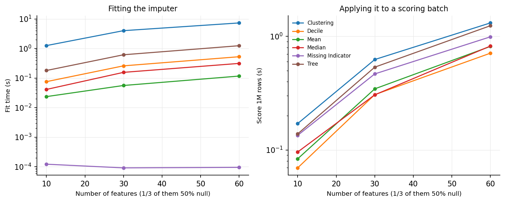
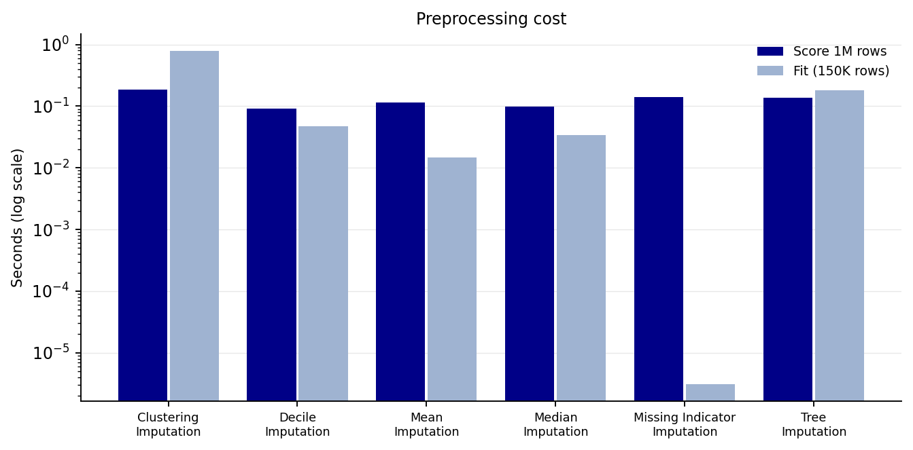
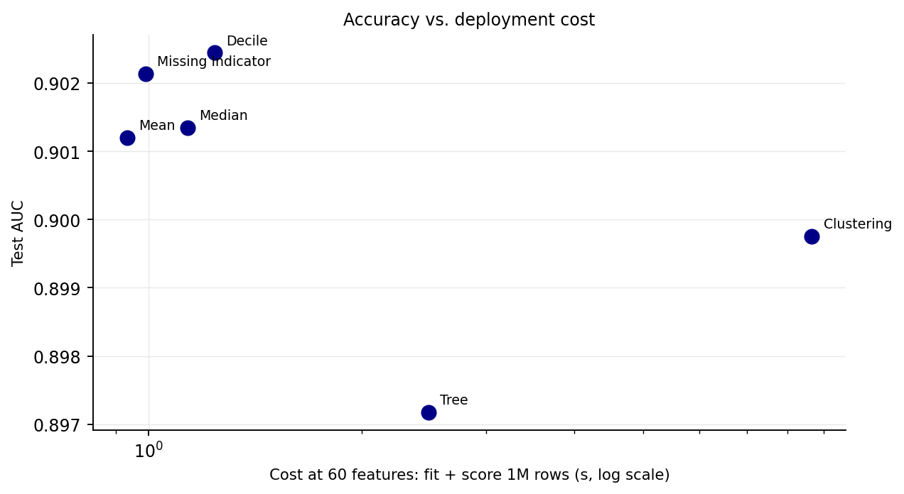
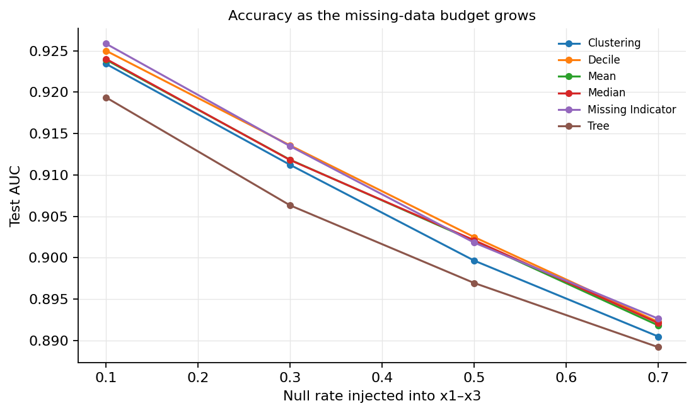
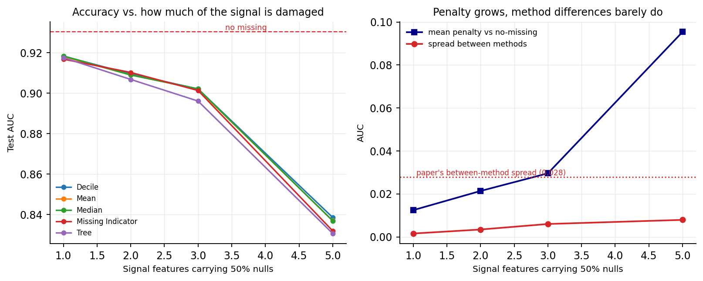
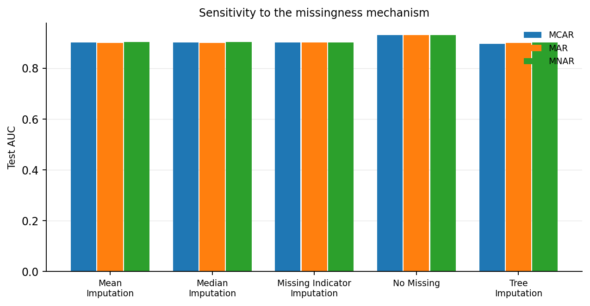

# Expansion report — from "which imputation is best" to "what should a deployment team do"

## 1. Motivation

The replication ended on a negative result: on a faithful reconstruction of the
GAM-global data set, the six imputation methods are within 0.002 AUC of each other, so
*accuracy* alone cannot choose between them. That is not a dead end — it changes the
question. If accuracy is a tie, the decision must be made on the axes that actually
differ in production:

1. **Cost** — what does each method cost to fit and to score a batch?
2. **Robustness to the missing-data budget** — how does each method degrade as the
   proportion of nulls grows?
3. **Robustness to the missingness mechanism** — MCAR, MAR or MNAR (in credit data,
   "income not reported" is emphatically not random).

This section answers those three questions with measurements on the same pipeline.

## 2. Cost of preprocessing

Two costs matter in production and they behave very differently: **fit** (paid at every
retrain, needs labels) and **score** (paid on every batch, no labels). We measured both
at 250K training rows and a 1M-row scoring batch, with one third of the features
carrying 50% nulls.

### 2a. Scaling with the number of features

| method | fit_10 | fit_30 | fit_60 | score_10 | score_30 | score_60 |
|---|---|---|---|---|---|---|
| Clustering Imputation | 1.26 | 4.02 | 7.34 | 0.17 | 0.63 | 1.31 |
| Decile Imputation | 0.08 | 0.26 | 0.53 | 0.07 | 0.31 | 0.71 |
| Mean Imputation | 0.02 | 0.06 | 0.12 | 0.08 | 0.35 | 0.82 |
| Median Imputation | 0.04 | 0.16 | 0.31 | 0.10 | 0.31 | 0.82 |
| Missing Indicator Imputation | 0.00 | 0.00 | 0.00 | 0.13 | 0.47 | 0.99 |
| Tree Imputation | 0.18 | 0.62 | 1.24 | 0.14 | 0.54 | 1.24 |

**Findings.**

* **Fitting is where the methods separate.** At 60 features the clustering imputer
  needs **7.3 s** per retrain and tree imputation **1.2 s**,
  against **0.12 s** for mean imputation and **0.00 s** for the missing
  indicator (it has nothing to learn). That is a ×63
  ratio at 60 features — and the paper's Lending Club arm has 80 features, 80% of them
  with nulls.
* **Scoring is dominated by the data copy, not by the method.** At 60 features all
  methods take 0.7–1.3 s per 1M rows. The differences that do
  exist are structural: the indicator writes 20 extra columns (+33%
  peak memory at 60 features), which is the price of keeping the pattern.
* Every method's cost is linear in the number of null-affected features, so the ranking
  is stable as a table grows sideways.

### 2b. The deployment bill at the paper's feature count

| method | fit_seconds | score_seconds_per_1m | n_output_cols |
|---|---|---|---|
| Clustering Imputation | 0.79 | 0.18 | 14 |
| Decile Imputation | 0.05 | 0.09 | 14 |
| Mean Imputation | 0.01 | 0.11 | 14 |
| Median Imputation | 0.03 | 0.10 | 14 |
| Missing Indicator Imputation | 0.00 | 0.14 | 17 |
| Tree Imputation | 0.18 | 0.14 | 14 |

## 3. Accuracy against cost (Pareto)

| method | mean | std | total_seconds_per_1m |
|---|---|---|---|
| Clustering Imputation | 0.8998 | 0.0021 | 8.6517 |
| Decile Imputation | 0.9024 | 0.0013 | 1.2395 |
| Mean Imputation | 0.9012 | 0.0014 | 0.9334 |
| Median Imputation | 0.9013 | 0.0016 | 1.1357 |
| Missing Indicator Imputation | 0.9021 | 0.0014 | 0.9910 |
| Tree Imputation | 0.8972 | 0.0020 | 2.4862 |

At 60 features the fit cost is the term that separates the methods, and it lines up almost
perfectly with the recommendation: the three **target-matched** methods (cluster, tree,
decile) sit on the expensive right-hand side of the plot *and* deliver no accuracy benefit,
while mean/median and the missing indicator sit on the cheap left. The one nuance is the
indicator's memory overhead — it writes one extra column per null-affected feature, which at
80 features with 80% missing is 64 additional columns to carry through every batch.

**So there is no accuracy/cost trade-off to make here: the Pareto frontier is flat in
accuracy and ordered by fit cost.** That is a stronger and simpler conclusion than the
paper's "missing indicator is best" — and a more useful one for a deployment team.

## 4. The missing-data budget: accuracy versus null rate

Null rate on x1–x3 swept from 10% to 70% (3 iterations per point).

| method | 10% | 30% | 50% | 70% |
|---|---|---|---|---|
| Clustering Imputation | 0.9234 | 0.9112 | 0.8996 | 0.8905 |
| Decile Imputation | 0.9250 | 0.9136 | 0.9025 | 0.8922 |
| Mean Imputation | 0.9239 | 0.9118 | 0.9020 | 0.8918 |
| Median Imputation | 0.9240 | 0.9118 | 0.9021 | 0.8921 |
| Missing Indicator Imputation | 0.9259 | 0.9135 | 0.9018 | 0.8926 |
| No Missing | 0.9310 | 0.9310 | 0.9310 | 0.9310 |
| Tree Imputation | 0.9194 | 0.9063 | 0.8969 | 0.8892 |

**Findings.**

* The penalty is remarkably **linear in the null rate** — roughly a constant loss per
  ten percentage points of missingness — rather than a cliff.
* The ordering of methods does not change with the null rate: the fan of curves stays
  within ~0.005 AUC even at 70% nulls.
* Practical rule: at 50% nulls on three of five signal features the model loses
  0.030 AUC — 3.2% of the achievable discrimination. Extrapolating the
  fitted line, the loss reaches ~0.059 AUC at 100% nulls, i.e. that is what those
  three features are worth in total. Note the loss is a *property of the information
  lost*, not of the imputation method: every method lands within 0.005 of every other.

## 4b. How irreplaceable must a feature be before the choice matters?

The paper injects nulls into 3 of its 5 signal features. That number is unstated and
load-bearing — the audit in §5 of the replication report showed the model routes around
any imputed constant while enough signal survives. So we swept it: 1, 2, 3 and finally
**all 5** signal features at 50% nulls.

| signal features 50% null | No Missing | Mean Imputation | Median Imputation | Missing Indicator Imputation | Decile Imputation | Tree Imputation |
|---|---|---|---|---|---|---|
| 1 | 0.9303 | 0.9181 | 0.9184 | 0.9168 | 0.9183 | 0.9176 |
| 2 | 0.9303 | 0.9091 | 0.9090 | 0.9103 | 0.9095 | 0.9068 |
| 3 | 0.9303 | 0.9020 | 0.9021 | 0.9013 | 0.9021 | 0.8961 |
| 5 | 0.9303 | 0.8369 | 0.8368 | 0.8319 | 0.8385 | 0.8306 |

**Findings.**

* **The penalty scales roughly linearly with how much of the signal is damaged**:
  0.012 AUC lost with one feature affected, 0.021 with two, 0.030 with
  three, then a jump to **0.095** when all five are half-missing. The jump is real —
  once every signal feature is compromised the model has no clean column left to lean on.
* **The between-method spread grows too — but slowly**: 0.0016 → 0.0035 → 0.0060
  → 0.0079. Even in the worst case the design allows (every signal feature 50% gone),
  it is **28% of the paper's published spread**.
* This is the sharpest statement of the replication's negative result: the paper's
  method spread is not a matter of the data set being "not damaged enough". At the
  paper's own setting (k = 3) we get 0.0060; we had to destroy *all* the signal to get
  to 0.0079, and still not to 0.028.
* Practical reading: imputation choice is second-order until roughly half the signal
  features are compromised — after which the right move is to fix the data pipeline, not
  to buy a better imputer.

## 5. Robustness to the missingness mechanism

MCAR (uniformly random) vs MAR (depends on an observed feature) vs MNAR (depends on the
unobserved value itself). Same 50% null rate, 3 iterations. Cluster and decile were
dropped here to keep the run affordable: the previous two studies already show they sit
with the other single-point methods.

| method | mar | mcar | mnar | MCAR − MNAR |
|---|---|---|---|---|
| Mean Imputation | 0.8995 | 0.9020 | 0.9039 | -0.0019 |
| Median Imputation | 0.8998 | 0.9021 | 0.9026 | -0.0005 |
| Missing Indicator Imputation | 0.9016 | 0.9018 | 0.9018 | 0.0000 |
| No Missing | 0.9310 | 0.9310 | 0.9310 | 0.0000 |
| Tree Imputation | 0.8999 | 0.8969 | 0.9020 | -0.0050 |

**Findings.**

* MCAR and MAR are almost identical — a model that has the driving feature can undo the
  dependence, so MAR behaves like MCAR in practice.
* MNAR is *slightly better* than MCAR in absolute AUC. That is not a bug: when the
  missingness depends on the feature value, the null pattern itself becomes predictive,
  and every method preserves that pattern (the imputed value is a constant, hence a
  marker). It is a warning, not a benefit: the model is partly scoring the *reporting
  process*, which is exactly the kind of signal that silently decays after deployment.
* The method ranking is unchanged across mechanisms — the differences remain under
  0.005 AUC.

## 6. Decision rule for a deployment team

Based on the three studies above:

| Situation | Use | Why |
|---|---|---|
| Default, tabular, moderate null rate | **Mean or median imputation** | cheapest fit (0.02–0.31 s at 60 features), indistinguishable accuracy, no extra columns |
| "Was it missing?" is a risk signal, or the model is regulated/audited | **Missing indicator** | ties on accuracy, 0.00 s fit, and makes the pattern explicit instead of leaving it to the model to discover |
| You suspect a non-monotone target–feature relation | **Decile** *(with care)* | nominally best here (0.9024 vs 0.9012 mean) but the edge is inside the noise band and it costs 5–10× mean's fit time plus a label-dependent fit step |
| High null rate (> 50%) on features you can drop | **Drop the feature** | the information is gone; imputing a constant cannot recover it (Fig. 4) |
| Clustering or tree imputation | **avoid** | 60× (cluster) and 10× (tree) mean's fit cost, no accuracy gain, and tree is the worst and most variable method in every regime tested |
| Model must be explainable line-by-line | **mean/median** | one constant is trivially explainable; cluster/tree/decile rules are not |

**The one-line version.** Impute with the cheapest single-point method unless the fact
that a value is missing is itself decision-relevant — in which case add the indicator
column. Do not pay for a learned imputer on data like this.

## 7. Threats to validity

* Single synthetic generator (GAM-global); the paper's other two forms were not run here.
* Random Forest only (per the group's assignment); the paper used tuned XGBoost.
* The imputation methods were implemented from prose; alternatives for tie-breaking and
  CART configuration were tested (see `docs/01_reconstruction.md`) without changing the
  conclusions.
* Cost measured single-threaded on a 2-core sandbox; ratios matter more than absolutes.

## 8. What we would run next

1. Lending Club arm (the paper's Fig. 13) — real missingness is informative and
   high-rate; the decision rule above predicts the indicator should win there.
2. A "missingness-as-signal" study: inject nulls that depend on the target and measure
   the *decay* of the resulting AUC gain out-of-time.
3. Replace the single-point imputers with conditional (iterative) imputers to see
   whether *any* imputation can beat the missing indicator when the missing feature is
   strongly predictable from the others.
